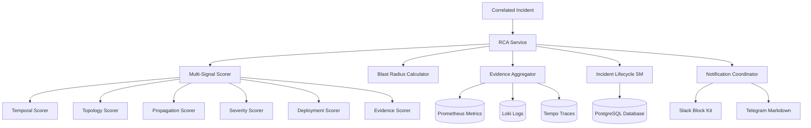

# RCA Service & Incident Lifecycle (Phase 4)

**Root Cause Analysis (RCA) & Incident Lifecycle Management Service** for the Cloud-Native Observability Platform.

Phase 4 bridges detection and incident response by providing automated root cause identification, blast radius calculation, multi-signal evidence aggregation, full incident lifecycle auditing (MTTR / MTTD), and multi-channel alerting (Slack Block Kit & Telegram).

---

## 🏗️ Architecture Overview



---

## 🎯 Core Features

### 1. Multi-Signal Root Cause Scoring
The RCA Ranker evaluates all impacted entities across 6 orthogonal dimensions:
$$\text{Score} = w_{\text{temp}} S_{\text{temp}} + w_{\text{topo}} S_{\text{topo}} + w_{\text{prop}} S_{\text{prop}} + w_{\text{sev}} S_{\text{sev}} + w_{\text{dep}} S_{\text{dep}} + w_{\text{evi}} S_{\text{evi}}$$

| Signal | Default Weight | Description |
| :--- | :---: | :--- |
| **Temporal** | 0.25 | Penalizes downstream delay; earliest anomaly onset receives score 1.0. |
| **Topology** | 0.25 | In caller $\rightarrow$ callee graphs, deep leaf dependencies and databases score highest. |
| **Propagation** | 0.20 | Ranks entities based on number of upstream dependents affected. |
| **Severity** | 0.15 | Considers anomaly severity level (`critical`, `high`) and z-score magnitude. |
| **Deployment** | 0.10 | Correlates failure with recent Git rollouts or Kubernetes deployments ($\le$ 30m). |
| **Evidence** | 0.05 | Rewards entities backed by multi-signal telemetry (metrics + logs + traces). |

### 2. Blast Radius Calculation
Traverses the service dependency graph backwards (callers of root cause) to discover:
- **Direct Impact (1-hop):** Immediate callers directly invoking the failing dependency.
- **Indirect Impact (2+ hops):** Upstream services impacted through intermediate propagation.
- **User-Facing Detection:** Flags if entrypoints (`frontend`, `api-gateway`, etc.) are compromised.
- **Estimated User Impact:** Classified as `critical`, `high`, `medium`, or `low`.

### 3. Evidence Aggregation & Unified Timeline
Aggregates telemetry evidence from:
- **Prometheus:** Current vs baseline metric deviation and deep links to Grafana Explore.
- **Loki:** Error logs and exception stack traces.
- **Tempo:** Distributed trace IDs exhibiting bottleneck span latencies.

### 4. Incident Lifecycle State Machine
Enforces strict transitions and tracks Mean Time to Detect (MTTD) and Mean Time to Resolve (MTTR):
$$\text{OPEN} \longrightarrow \text{ACKNOWLEDGED} \longrightarrow \text{INVESTIGATING} \longrightarrow \text{MITIGATED} \longrightarrow \text{RESOLVED} \longrightarrow \text{CLOSED}$$
- **Auto-Resolver:** Background scheduler automatically resolves incidents after telemetry returns to baseline for a configurable duration (default 15 mins).

### 5. Multi-Channel Notifications
- **Slack:** Rich Block Kit cards with interactive buttons (Acknowledge, Grafana Dashboard deep link), color coding, and candidate breakdowns.
- **Telegram:** Clean Markdown alerts with severity emojis, key metrics, and direct links.
- **Deduplication:** Suppresses duplicate notifications within a 15-minute sliding window unless severity escalates.

---

## 🔌 API Reference (Port 8082)

| Method | Path | Description |
| :--- | :--- | :--- |
| `GET` | `/health` | Health check & database connection status |
| `GET` | `/metrics` | Prometheus metrics endpoint |
| `GET` | `/api/v1/root-causes/{incident_id}` | Compute ranked root cause candidates and confidence |
| `GET` | `/api/v1/root-causes/{incident_id}/blast-radius` | Compute blast radius and user impact rating |
| `GET` | `/api/v1/incidents/{incident_id}/evidence` | Retrieve aggregated multi-signal evidence items |
| `GET` | `/api/v1/incidents/{incident_id}/timeline` | Audit log of state transitions, comments, and RCA runs |
| `POST` | `/api/v1/incidents/{incident_id}/acknowledge` | Move incident to `ACKNOWLEDGED` and record MTTD |
| `POST` | `/api/v1/incidents/{incident_id}/investigate` | Move incident to `INVESTIGATING` |
| `POST` | `/api/v1/incidents/{incident_id}/mitigate` | Move incident to `MITIGATED` |
| `POST` | `/api/v1/incidents/{incident_id}/resolve` | Move incident to `RESOLVED` and record MTTR |
| `POST` | `/api/v1/incidents/{incident_id}/close` | Move incident to `CLOSED` |
| `POST` | `/api/v1/incidents/{incident_id}/comment` | Add investigation comment to audit timeline |
| `POST` | `/api/v1/notifications/dispatch/{id}` | Manually trigger dispatch of incident alert |
| `POST` | `/api/v1/notifications/test` | Test Slack and Telegram notification payloads |

---

## 🧪 Running Tests

Unit and integration tests run offline without requiring external network access:

```bash
cd services/rca-service
python -m pytest tests/ -v
```

---

## 🚀 Deployment & Demo on Minikube

### 1. Apply Database Migration
```bash
kubectl exec -i deployment/detection-postgres -n observability -- \
  psql -U detection -d detection_db < migrations/003_create_rca_and_lifecycle_tables.sql
```

### 2. Build and Deploy Docker Image
```bash
eval $(minikube docker-env)
docker build -t rca-service:latest .
kubectl apply -f k8s/rca-deployment.yaml
kubectl rollout status deployment/rca-service -n observability
```

### 3. Run Demo Script
```bash
# In terminal 1: Port-forward RCA service
kubectl port-forward svc/rca-service 8082:8082 -n observability

# In terminal 2: Run demo
python scripts/demo_phase4.py
```
